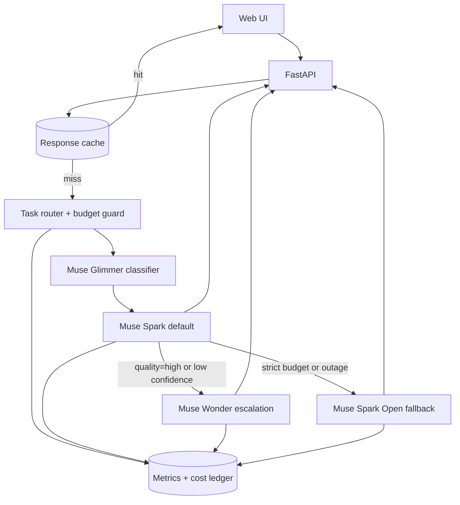
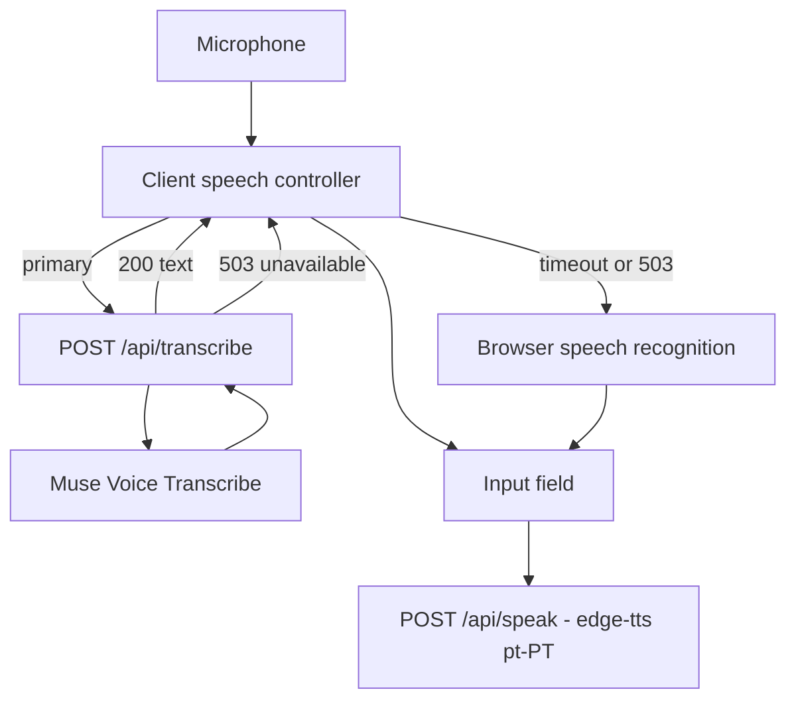
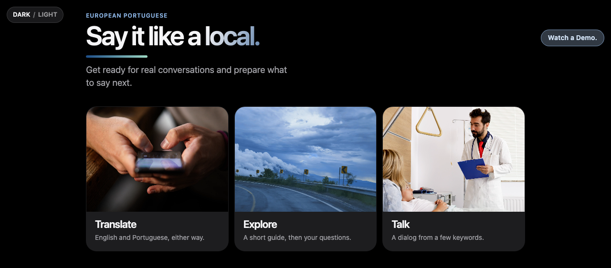
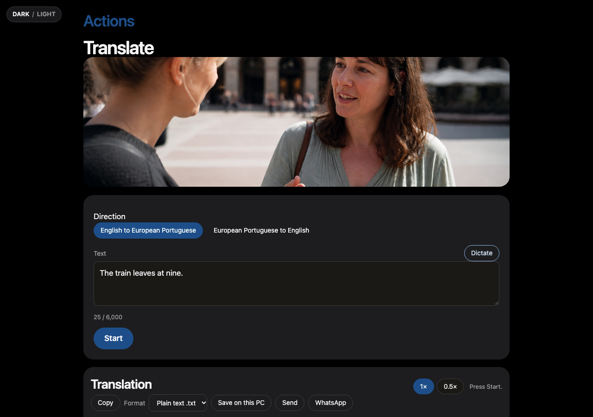
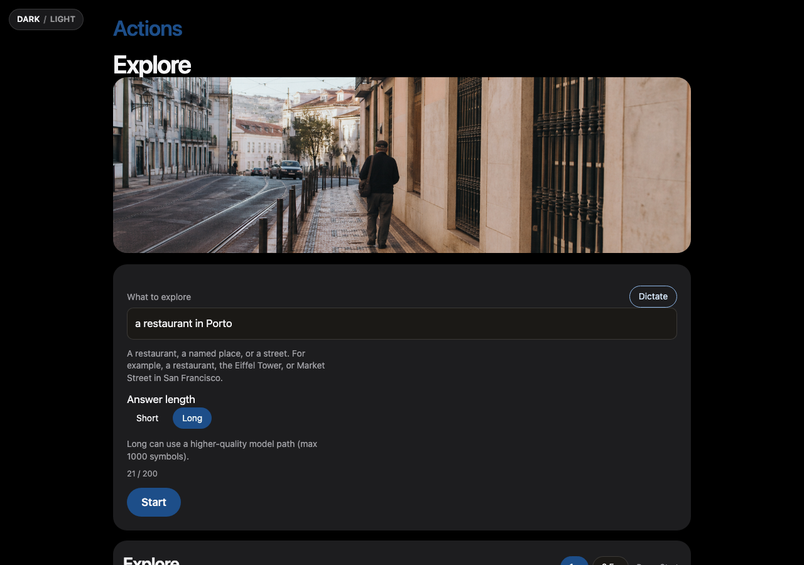
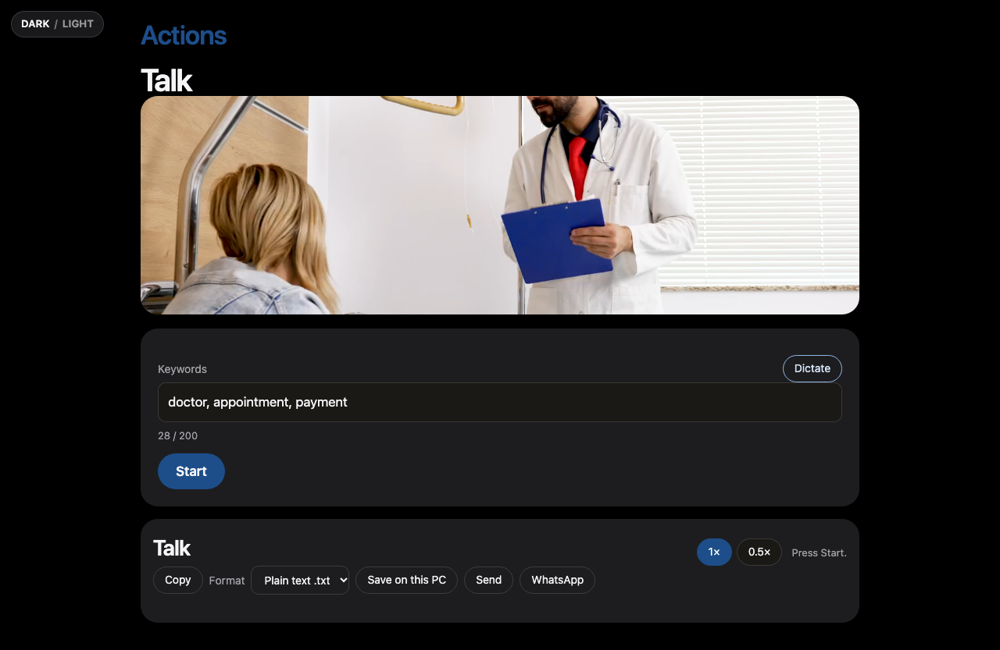
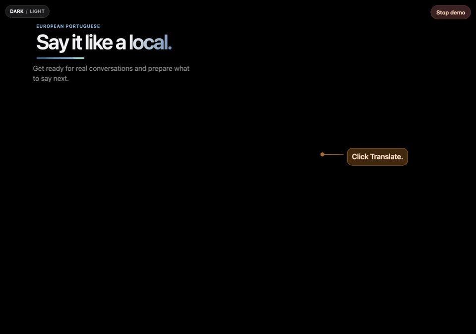

# PT-PT Learning Companion

[](https://www.python.org/)
[](https://fastapi.tiangolo.com/)
[](https://www.uvicorn.org/)
[](https://docs.pydantic.dev/)
[](https://www.python-httpx.org/)
[](https://github.com/rany2/edge-tts)
[](https://docs.pytest.org/)
[](LICENSE)

Local FastAPI app and one HTML page for European Portuguese: Translate, Explore, and Talk. Proof of concept. No auth, no CI, no persisted metrics.

## Tools

| Tool | Where it is used |
| --- | --- |
| Python 3.12 | The package in `src/pt_pt_learning_companion/`. |
| FastAPI and Uvicorn | The local app and the routes below. |
| Pydantic | Request and response models in `schemas.py`. |
| httpx | `MetaTextClient` posts to the Meta Model API. |
| python-dotenv | `create_app()` reads a git-ignored `.env`. |
| edge-tts | Portuguese playback, voice `pt-PT-RaquelNeural`. No speech key. |
| Web Speech API | Dictate in the browser. |
| Meta Model API | Live text when `MODEL_API_KEY` is set. Default model `muse-spark-1.3`. |
| pytest | `tests/`. |

## Architecture

Two decisions are written down as ADRs. Option B is the chosen design in both. The diagrams below are those decisions. The code today runs a thinner path: the page sends `quality=standard`, so text uses Muse Spark only; Wonder does not escalate because the live client reports confidence `1.0`; Glimmer, Muse Image, and SAM are named and not called. Dictation in the browser uses the Web Speech API. Watch a Demo never calls the model.

| Document | What it decides |
| --- | --- |
| [ADR 0001](docs/adr/0001-ai-model-routing-strategy.md#system-design-option-b--chosen) | Text routing. Option B: Glimmer classifies, Spark is the default, Wonder escalates, Spark Open is the fallback. |
| [ADR 0002](docs/adr/0002-speech-stack-strategy.md#system-design-option-b--chosen) | Speech. Option B: Muse Voice Transcribe first, browser recognition on `503`, edge-tts for Play. |
| [Meta model architecture](docs/meta-model-architecture.md) | Target service map, model roles, and budgets. |
| [AI design](docs/ai-design.md) | When each model is meant to run. Marked as target design, not the running code. |
| [Model overview](docs/meta-model-overview.md) | Per-model notes for this product. |

### Text routing, Option B

Full write-up: [ADR 0001, Option B](docs/adr/0001-ai-model-routing-strategy.md#system-design-option-b--chosen).



### Speech, Option B

Full write-up: [ADR 0002, Option B](docs/adr/0002-speech-stack-strategy.md#system-design-option-b--chosen).



Each ADR also draws Option A and Option C and scores them. Option B wins both matrices: 26 for routing, 25 for speech.

The page is [`preview/index.html`](preview/index.html). The Python package is `src/pt_pt_learning_companion/`.

It opens with a short floating intro, then three actions. **Watch a Demo** walks through those same screens with scripted sentences and does not call the model. A real session calls `/api/generate` for the text and `/api/speak` for Play.

## What you can do

**Translate.** English and European Portuguese, either way. Type or dictate, then Start. The answer is a bilingual table. Play reads the Portuguese line. Say repeats it for practice. Switching direction clears the text and the previous translation.

**Explore.** Name a place or a request, such as a restaurant in Porto. Choose Short or Long before Start. The guide stays on the left. Follow-up questions, further choices, and Ask sit on the right. A place can open in Google Maps.

**Talk.** A few keywords become a bilingual dialog. Choices sit beside the answers. Ask your question is directly under those choices. A new question brings a new set of choices.

Previous answers stay on screen while the next one is processing. Copy, save as text or Word, send, or open WhatsApp from the result.

## Screens

Home, with Translate, Explore, and Talk:



Translate, English to European Portuguese:



Explore, with Short or Long chosen before Start:



Talk, from a few keywords:



## A piece of the demo

This clip is only the opening of Watch a Demo: the prompt, the typed sentence, and the bilingual lines. The rest of the demo continues through direction switching, Explore, and Talk. Stop demo is visible only while that walkthrough is running.



## Run

```bash
python3.12 -m venv .venv
source .venv/bin/activate
pip install -e ".[dev]"
cp .env.example .env
uvicorn pt_pt_learning_companion.app:app --reload --port 8000
```

Open http://127.0.0.1:8000. `app.py` calls `load_dotenv()` on startup, so a local `.env` is read then. `.env` is git-ignored. Never commit `MODEL_API_KEY`.

```bash
pytest
```

## Python layout

| Module | What it does |
| --- | --- |
| `app.py` | Builds the FastAPI app, loads `.env`, and registers the routes below. `create_app()` accepts a model, speaker, text service, and transcriber so tests can inject fakes. |
| `schemas.py` | Pydantic request and response models. |
| `ai_router.py` | `plan_model_route()` picks Spark, Wonder, or Spark Open from `quality` and `budget_mode`. It does not call a model. `model_base_url()` and `tls_verify()` are the single API URL and CA lookup. |
| `ai_models.py` | `RoutedTextService.run()` executes that plan. `MetaTextClient` posts to `/chat/completions`. `StubTextClient` is used when no key is set. |
| `providers.py` | Separate study client for `POST /api/study`. Same stub-or-Meta rule, not the router. |
| `speech.py` | `synthesize()` uses edge-tts (`pt-PT-RaquelNeural`, no key). `build_transcriber()` returns Muse Voice Transcribe when a key is set, otherwise a stub that fails so the browser can dictate. |

`MODEL_API_KEY` set → Meta at `MODEL_BASE_URL` (default `https://api.meta.ai/v1`). Unset → offline stub. `MODEL_NAME` defaults to `muse-spark-1.3`.

What the router actually calls today: the page sends `quality=standard`, so `/api/generate` uses Spark only. Wonder runs only for `quality=high` when the client reports confidence under 0.6. The live client always reports `1.0`, so Wonder does not run. Glimmer is named on the plan and is not requested. Spark Open runs when Spark raises. Dictation in the browser uses the Web Speech API, not `/api/transcribe`.

A corporate TLS proxy re-signs `api.meta.ai`. `tls_verify()` keeps verification on and uses `MODEL_CA_BUNDLE` or `.certs/trust-bundle.pem` when that file exists.

## HTTP API

| Method | Path | Handler |
| --- | --- | --- |
| `GET` | `/` | Serves `preview/index.html`. |
| `GET` | `/health` | `{"status":"ok"}`. |
| `GET` | `/api/editorial-videos` | Up to three video files from `~/Downloads`. |
| `POST` | `/api/generate` | Routed text. Body: `task` (`translate`, `explore`, `situation`), `text`, optional `quality` (`standard` or `high`), `budget_mode`. Returns text, route, and token counts. |
| `POST` | `/api/model-plan` | The route only. No model call. |
| `POST` | `/api/study` | Translation, vocabulary, and exercises for one passage. |
| `POST` | `/api/speak` | MP3 for a Portuguese line. Body: `text`, `rate` from 0.5 to 1. |
| `POST` | `/api/transcribe` | Multipart audio. `503` when the transcriber is the stub. |

Live check:

```bash
curl -s localhost:8000/api/generate -H 'content-type: application/json' \
  -d '{"task":"translate","text":"Where is the train station?","quality":"standard"}'
```

`python scripts/smoke_option_b.py` runs the same routed path from the shell.

Token counts come back on `GenerateResponse.usage` (`prompt_tokens`, `completion_tokens`, `total_tokens`). Nothing is written to disk.

## Page

`preview/index.html` is plain HTML, CSS, and JavaScript. It calls `/api/generate` for Translate, Explore, and Talk, and `/api/speak` for Play. Watch a Demo stays on scripted sentences and does not call the model. The floating intro plays when the app opens, not inside the demo.

## Agent skills

`skills/` is plain markdown. Any editor or model can read it. Nothing in that folder is tied to one IDE.

| Skill | Use when |
| --- | --- |
| [Model transport safety](skills/model-transport-safety/model-transport-safety.md) | Changing model calls, speech, `.env`, TLS, CORS, or downloads. |
| [Module boundaries](skills/module-boundaries/module-boundaries.md) | Adding a route, client, prompt, or moving a module. Then update the Python layout table above. |

## Before production

Tests beyond the current pytest modules, structured logs, metrics, auth, a lockfile, and CI. Caching, budget enforcement, and a real confidence signal are in the architecture above and are not running yet.

Meta API reference: <https://dev.meta.ai/docs/api-reference>. Model list: <https://dev.meta.ai/docs/models>.
