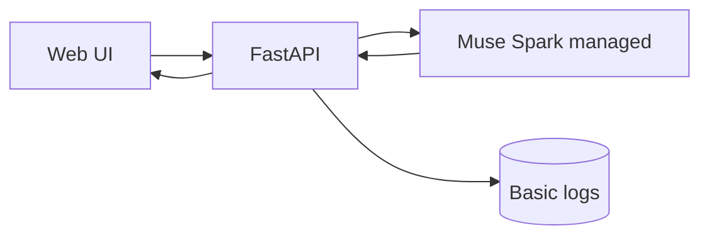
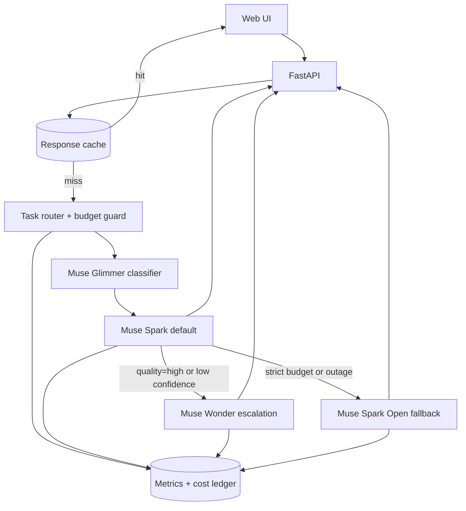
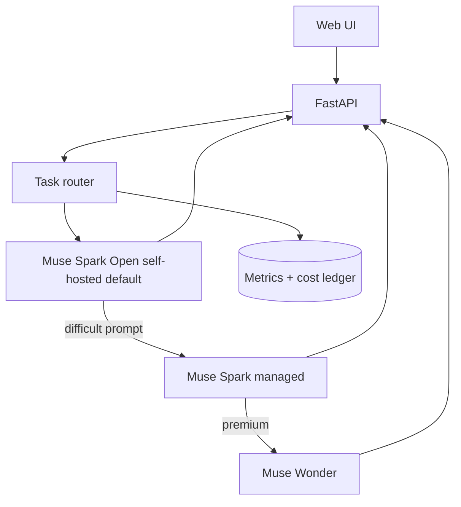

# ADR 0001: AI Model Routing Strategy

- **Status:** Accepted (initial rollout)
- **Owners:** Halyna Hriaznova
- **Related docs:** [README architecture](../../README.md#architecture), `docs/ai-design.md`, `docs/meta-model-architecture.md`, `docs/meta-model-overview.md`

## Context

PT-PT Learning Companion needs an AI architecture for `Translate`, `Explore`, and `A situation` that balances:

- low latency for interactive UX
- good European Portuguese quality
- predictable production cost
- operational simplicity and reliability

We also want to leverage Meta-managed models and Meta open-weights models with explicit routing logic.

## Actuality Review

This ADR was re-checked against the codebase and remains accurate:

- `POST /api/model-plan` exists (`src/pt_pt_learning_companion/app.py`) and returns routing decisions via `plan_model_route` (`src/pt_pt_learning_companion/ai_router.py`).
- `POST /api/generate` now **executes** the plan via `RoutedTextService` (`src/pt_pt_learning_companion/ai_models.py`): Spark default, Wonder escalation on low-confidence `quality=high`, and Spark Open fallback on error or strict budget. It returns the route taken and token usage. A stub client keeps this working with no key.
- Request-level controls `quality`, `budget_mode`, and `require_managed` are implemented in `ModelPlanRequest` (`src/pt_pt_learning_companion/schemas.py`).
- Model-role and budget env vars are scaffolded in `.env.example`; set `MODEL_API_KEY` to route to real models.
- Still pending: a real confidence signal for escalation (the live client currently reports full confidence), persisted telemetry, caching, and budget enforcement.

Verdict: **Decision (Option B) still valid.** No change to the decision; diagrams added below for each option.

## Decision Drivers

1. **Performance** (p95 latency)
2. **Cost control** (daily spend and per-request predictability)
3. **Quality** (accuracy and naturalness of output)
4. **Operational complexity** (implementation and maintenance burden)
5. **Resilience** (fallback behavior during outages/quota issues)
6. **Vendor risk** (lock-in and portability)

## Options Considered

## Option A — Single managed model for everything

Use one managed model (e.g., Muse Spark series) for all text requests.

### Pros

- Simple to implement and operate
- Consistent behavior across features
- Fewer routing bugs

### Cons

- Limited cost flexibility under heavy load
- No explicit high-quality escalation path
- Weaker resilience if managed endpoint has issues
- Harder to optimize per feature

### System design (Option A)

Single managed model handles every text request. No classifier, no escalation, no open-weights fallback.

## Option B — Cost-aware hybrid routing (managed + open-weights)

Use Glimmer for routing/classification, Spark as default, Wonder for selective escalation, and Spark Open fallback/strict-budget mode.

### Pros

- Strong cost control through routing and budget modes
- Better quality when needed via selective escalation
- Resilience through open-weights fallback
- Tunable per feature without rewriting product logic

### Cons

- More moving parts and implementation complexity
- Requires routing telemetry and observability discipline
- Additional testing needed for routing correctness

### System design (Option B — chosen)

The same diagram is on the [README architecture](../../README.md#text-routing-option-b) page.

Cheap classifier picks the path; Spark serves most traffic; Wonder is gated by `quality`/budget; Spark Open covers strict-budget and outage cases.

## Option C — Open-weights first, managed escalation

Default to Spark Open for most requests, escalate to Spark/Wonder for difficult prompts.

### Pros

- Lowest baseline cost potential
- Reduced managed API dependency
- Good for batch/background workloads

### Cons

- Potentially higher latency/variance depending on hosting stack
- Higher infra ownership burden
- Quality consistency risk for user-facing real-time interactions

### System design (Option C)

Self-hosted Spark Open is the default; managed Spark/Wonder are escalation-only. Shifts cost toward infra ownership and away from per-call API spend.

## Comparison Matrix

Scores: 1 (weak) to 5 (strong)

| Criterion | Option A: Single managed | Option B: Hybrid routing | Option C: Open-first |
| --- | --- | --- | --- |
| Performance | 4 | 4 | 3 |
| Cost control | 2 | 5 | 4 |
| Quality | 4 | 5 | 3 |
| Operational simplicity | 5 | 3 | 2 |
| Resilience | 2 | 5 | 4 |
| Vendor risk | 2 | 4 | 5 |
| **Total** | **19** | **26** | **21** |

## Decision

**Decision: choose Option B (Cost-aware hybrid routing).**

Reason:

- Best overall balance for interactive product quality and production cost
- Provides explicit fallback strategy and budget controls
- Supports gradual rollout with minimal UX disruption

## Consequences

### Positive

- Predictable and tunable spend behavior
- Higher quality path available only when needed
- Better uptime posture through fallback

### Negative

- More complexity in routing logic and testing
- Requires telemetry to prevent silent cost drift

## Implementation Status

- `POST /api/model-plan` is implemented as a control-plane routing endpoint.
- Request-level controls are implemented: `quality`, `budget_mode`, `require_managed`.
- Model role env vars are scaffolded in `.env.example`.
- Telemetry persistence and budget enforcement are still pending.

## Rollout Plan

1. Implement control-plane endpoint (`/api/model-plan`) for transparent routing decisions.
2. Wire request-level controls: `quality`, `budget_mode`, `require_managed`.
3. Add telemetry: latency, estimated units, escalation rate, fallback rate.
4. Add thresholds:
   - max escalation rate
   - daily spend guardrail
5. Validate in staging with synthetic and real prompts.
6. Promote to production behind feature flags.

## Open Questions

- What escalation rate target is acceptable at launch (e.g., 5% vs 10%)?
- Should strict budget mode be user-visible or internal only?
- What quality gate should trigger Wonder escalation automatically?

## Decision Review Trigger

Revisit this ADR when one of the following happens:

- monthly inference spend exceeds target by >20%
- p95 latency misses target for 2 consecutive releases
- quality complaints rise in user feedback for translation/situation flows

## Notes and assumptions

- Pricing and capability assumptions come from public Meta pages at decision time and can change; treat this ADR as directional, not as a billing contract.
