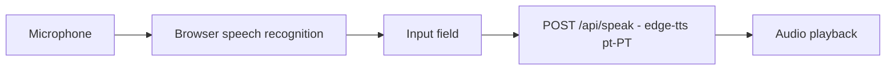
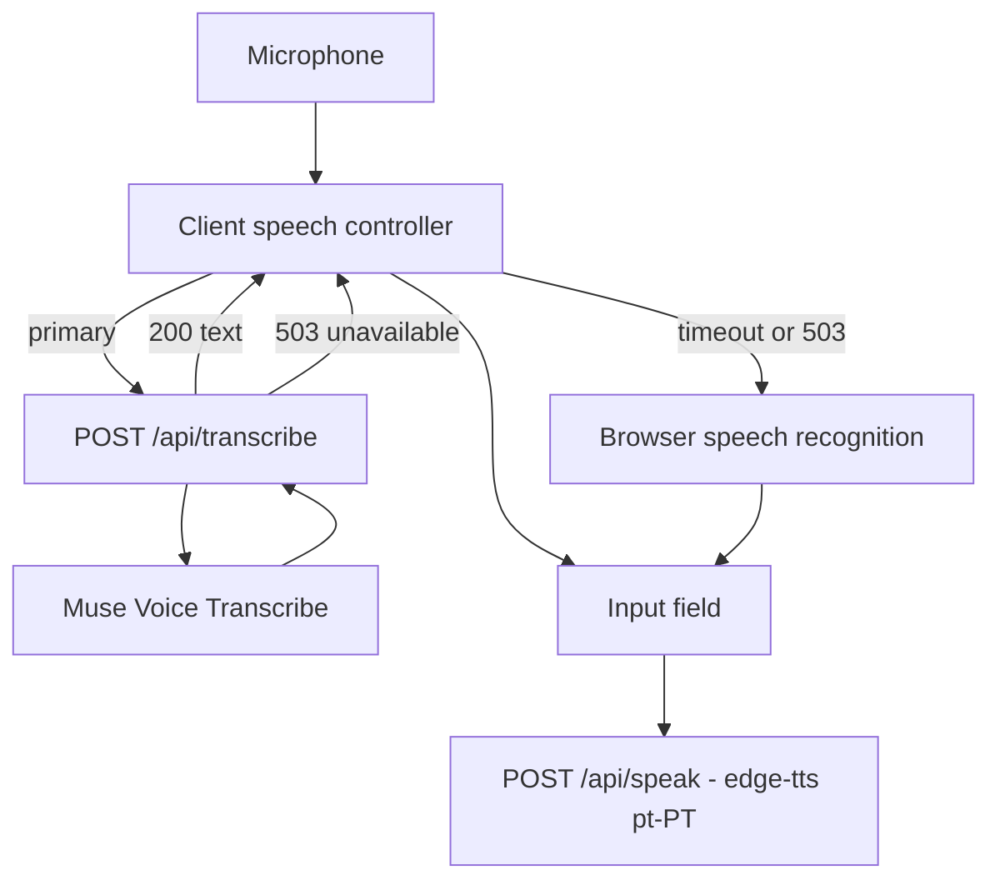
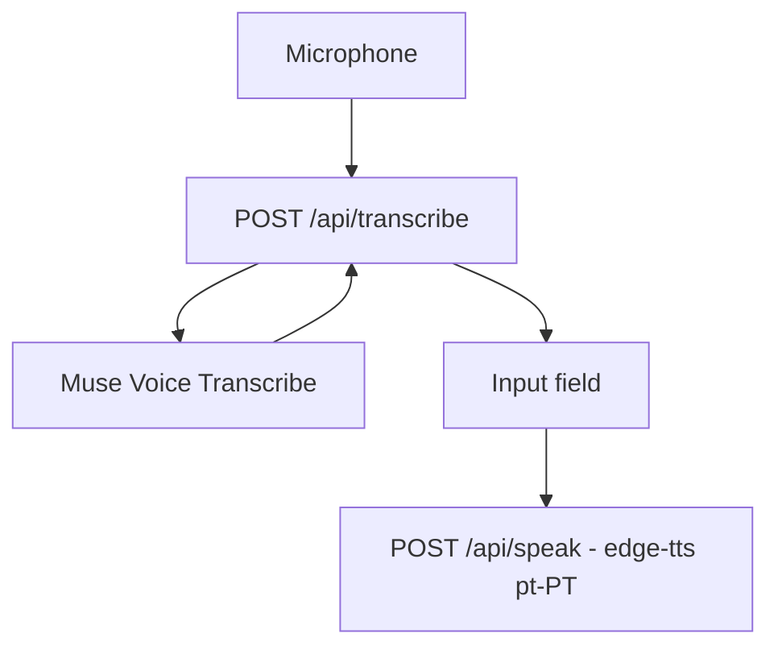

# ADR 0002: Speech Stack Strategy (Browser vs Managed Transcription)

- **Status:** Accepted (initial rollout)
- **Owners:** Halyna Hriaznova
- **Related docs:** `docs/ai-design.md`, `docs/meta-model-overview.md`

## Implementation status

Option B (hybrid) is now partially implemented:

- `POST /api/transcribe` accepts an audio clip and calls Muse Voice Transcribe via the Meta Model API (`speech.MetaTranscriber`).
- When no managed provider is configured, or the managed call fails, the endpoint returns `503` so the client falls back to browser-native recognition.
- Text-to-speech stays on `POST /api/speak` (European Portuguese neural voice).
- Pending: client audio capture (MediaRecorder) wiring in the preview, streaming transcription, speaker attribution, and telemetry (latency, fallback rate, spend).

## Context

The product relies on speech for two core interactions:

- dictation into input fields
- phrase-by-phrase listening and practice feedback

Today, dictation is browser-native and text-to-speech uses a local `/api/speak` route. We need a production speech strategy that balances accuracy, latency, cost, and privacy/resilience.

## Decision Drivers

1. **Transcription quality** in realistic noisy environments
2. **Latency** for interactive dictation UX
3. **Cost predictability** at production scale
4. **Operational complexity**
5. **Fallback resilience** when one path fails
6. **Data handling** and privacy posture

## Options Considered

## Option A — Browser-native speech only

Use browser recognition for dictation and keep current play flow.

### Pros

- Lowest backend complexity
- No dedicated transcription bill
- Works quickly for prototypes

### Cons

- Inconsistent quality across browsers/devices
- Weak control over speaker attribution/advanced behaviors
- Harder to guarantee production consistency

### System design (Option A)

All recognition happens in the browser; the backend only synthesizes speech.

## Option B — Hybrid (managed primary + browser fallback)

Use Muse Voice Transcribe as primary transcription service and browser-native recognition as fallback.

### Pros

- Better transcription consistency and controlled behavior
- Production-grade streaming features and speaker-aware capabilities
- Graceful degradation if managed API is unavailable

### Cons

- More system complexity than browser-only
- Additional operational cost
- Requires backend pipeline and monitoring

### System design (Option B — chosen)

Managed transcription is the default; a timeout or `503` degrades gracefully to browser recognition, so dictation always works.

## Option C — Managed transcription only

Use Muse Voice Transcribe exclusively for all dictation.

### Pros

- Most consistent recognition behavior
- Unified backend control and observability

### Cons

- No offline/browser fallback path
- Highest dependency on single external service path
- User impact is larger during provider disruption

### System design (Option C)

Every dictation goes through the managed model with no fallback path.

## Comparison Matrix

Scores: 1 (weak) to 5 (strong)

| Criterion | Option A: Browser only | Option B: Hybrid | Option C: Managed only |
| --- | --- | --- | --- |
| Accuracy consistency | 2 | 5 | 5 |
| Latency control | 3 | 4 | 4 |
| Cost predictability | 5 | 4 | 3 |
| Operational simplicity | 5 | 3 | 3 |
| Resilience | 3 | 5 | 2 |
| Privacy/control posture | 2 | 4 | 4 |
| **Total** | **20** | **25** | **21** |

## Decision

Chose **Option B (Hybrid)**:

- primary: Muse Voice Transcribe
- fallback: browser-native recognition

Why:

- best balance of production-grade quality and operational resilience
- avoids hard lock on one speech path
- keeps an immediate fallback when provider issues occur

## Architecture impact

- Add a server endpoint for transcription requests (streaming or chunked)
- Keep client-side browser recognition path as fallback
- Add routing rules:
  - use managed path by default in production
  - auto-fallback to browser when managed path is unavailable or times out

## Cost assumptions

- Muse Voice Transcribe pricing signal at decision time: around `$0.18/hour` (`$3.00 / 1000 minutes`).
- Expected cost fit is strong for focused dictation UX, but spend must be monitored against real session duration.

## Rollout Plan

1. Add managed transcription endpoint and contract.
2. Add client fallback logic and user-visible status messaging.
3. Add telemetry:
   - transcription latency
   - fallback rate
   - transcription errors
   - estimated speech spend
4. Enable gradually behind feature flag.
5. Compare quality and failure rates vs browser-only baseline.

## Open Questions

- Do we expose a user-visible “High accuracy speech” toggle?
- What timeout should trigger fallback to browser speech?
- Should speaker-attribution mode be enabled by default or only in advanced flows?

## Decision Review Trigger

Revisit this ADR when:

- fallback rate exceeds target for 2 consecutive releases
- speech cost exceeds target by >20% for a month
- dictation quality complaints increase in user feedback
