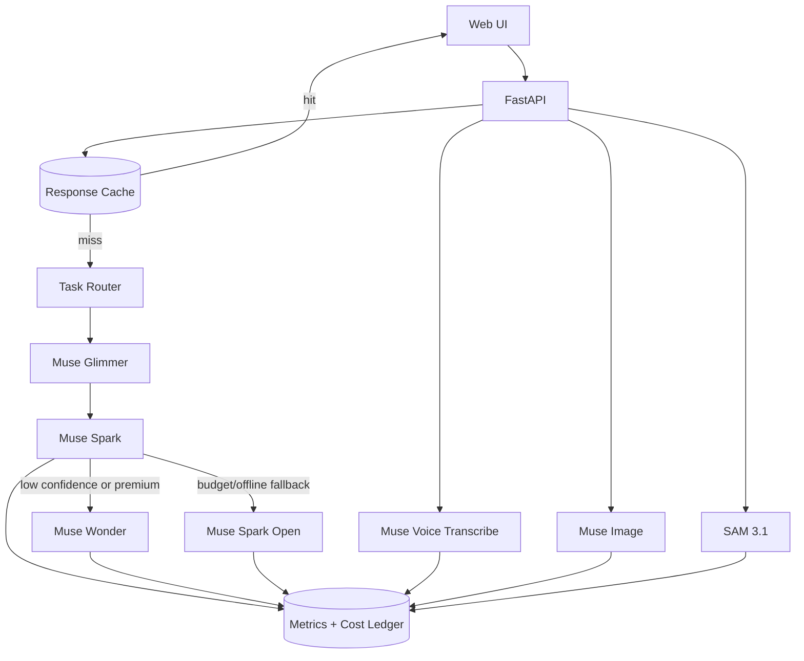

# Meta Model Architecture (Cost-Optimized v1)

This document defines the initial architecture for integrating Meta models in PT-PT Learning Companion with a strong cost/quality balance.

> **PoC status:** This describes the target architecture. The current build is a Proof of Concept. Implemented: the routing *plan* (`/api/model-plan`), routed *execution* (`/api/generate`: Spark default, Wonder escalation, Spark Open fallback), and managed transcription (`/api/transcribe`). Still pending: caching, metrics, budget enforcement, and client audio capture. See [Before production](../README.md#before-production).

## Reference documentation

Official Meta documentation for the API and the models used here:

- **Meta Model API reference:** https://dev.meta.ai/docs/api-reference
- **Meta Model API base URL:** `https://api.meta.ai/v1`
- **Model catalog / descriptions:** https://dev.meta.ai/docs/models
- **Managed models:** [Muse Spark](https://dev.meta.ai/docs/models/muse-spark), [Muse Wonder](https://dev.meta.ai/docs/models/muse-wonder), [Muse Image](https://dev.meta.ai/docs/models/muse-image), [Muse Voice Transcribe](https://dev.meta.ai/docs/models/muse-voice-transcribe), [SAM 3.1](https://dev.meta.ai/docs/models/sam-3-1)
- **Open-weights models:** [Muse Glimmer](https://dev.meta.ai/docs/models/muse-glimmer), [Muse Spark Open](https://dev.meta.ai/docs/models/muse-spark-open)
- **Coding agent:** [Muse Code](https://dev.meta.ai/docs/muse-code)
- **Token usage & billing:** https://dev.meta.ai/docs/usage

> If any URL above 404s, start from the docs root (https://dev.meta.ai/docs) — Meta occasionally reorganizes page slugs. Per-model "when/why/trade-offs" notes for this product live in [meta-model-overview.md](meta-model-overview.md).

## Goals

- Use Meta Model API as the primary managed-model path.
- Use open-weights Meta models for low-cost routing and fallback.
- Keep high-cost models behind explicit escalation gates.
- Preserve low latency for interactive UX.

## Model roles

### Managed via Meta Model API

- **Muse Spark series** (`muse-spark-1.3` by default): primary text generation for Translate, Explore, and A situation.
- **Muse Wonder**: quality escalation for difficult prompts and high-value rewrites.
- **Muse Image**: optional visual assets (topic cover cards, social preview images, onboarding stills).
- **Muse Voice Transcribe**: server-side dictation/transcription for stable microphone UX.
- **SAM 3.1**: segmentation and smart crops for video/image assets used in onboarding/demo scenes.

### Open weights (self-host or dedicated inference)

- **Muse Glimmer**: lightweight intent, language, and complexity classifier.
- **Muse Spark Open**: low-cost text generation fallback and background/batch generation.

### Development velocity

- **Muse Code**: coding-agent workflow for implementation speed, refactors, and test scaffolding.

## Cost-optimized routing strategy

1. **Zero-model path first (free):**
   - deterministic UI transforms, cached responses, static phrase packs.
2. **Cheap classifier pass (Glimmer):**
   - detect task type, language direction, complexity, and confidence.
3. **Default generation (Spark):**
   - run standard text outputs for most requests.
4. **Escalation (Wonder):**
   - only when Spark confidence is low, user asks for premium quality, or safety/language constraints require refinement.
5. **Open-weights fallback (Spark Open):**
   - when managed API budget is exhausted or during offline/air-gapped modes.

## Routing matrix

| Feature | Primary | Fallback | Escalation | Why |
| --- | --- | --- | --- | --- |
| Translate EN<->PT | Muse Spark | Muse Spark Open | Muse Wonder | Spark is good enough for most rows; Wonder only for nuanced rewrites |
| Explore | Muse Spark | Muse Spark Open | Muse Wonder | Balanced speed/quality for short guides |
| A situation | Muse Spark | Muse Spark Open | Muse Wonder | Dialog quality improves with occasional escalation |
| Dictation | Muse Voice Transcribe | Browser speech | - | Better consistency than browser-only transcription |
| Visual assets | Muse Image | static assets | - | Optional branding and richer onboarding |
| Scene extraction/cropping | SAM 3.1 | manual crop | - | Better framing for demo cards/video thumbnails |
| Intent/lang classifier | Muse Glimmer | regex rules | - | Very low-cost router input |

## Control plane and budgets

- **Per-request budget cap:** hard token/cost ceiling by feature.
- **Daily project budget:** total managed API spend cap.
- **Escalation budget:** separate quota for Wonder to prevent accidental overuse.
- **Caching:** prompt+inputs hash cache for idempotent requests.
- **Telemetry:** latency, token usage, cache hit rate, escalation rate, fallback rate.

Recommended defaults:

- Escalation target: <= 10% of requests.
- Cache target: >= 35% on repeated demo/training flows.
- P95 latency target:
  - Translate <= 2.5s
  - Explore <= 3.0s
  - A situation <= 3.5s

## Initial service architecture



## Environment and model configuration

Use these variables as the initial config surface:

- `MODEL_API_KEY=...` — save it in a local, git-ignored `.env`, never commit it. Unset → offline stub; set → Meta Model API.
- `MODEL_BASE_URL=https://api.meta.ai/v1`
- `MODEL_NAME=muse-spark-1.3` (default text model)
- `META_MODEL_WONDER=muse-wonder`
- `META_MODEL_IMAGE=muse-image`
- `META_MODEL_TRANSCRIBE=muse-voice-transcribe`
- `META_MODEL_SAM=sam-3-1`
- `META_MODEL_GLIMMER=muse-glimmer`
- `META_MODEL_SPARK_OPEN=muse-spark-open`

Optional budget controls:

- `MODEL_BUDGET_DAILY_USD=10`
- `MODEL_BUDGET_ESCALATION_USD=2`
- `MODEL_ESCALATION_RATE_MAX=0.10`

## Tracking token usage

**Where tokens are reported.** Each Meta Model API response includes a `usage` object. This is the authoritative source of *actual* usage — the `estimated_cost_units` field returned by `/api/model-plan` is only a pre-call estimate.

```json
{
  "usage": { "prompt_tokens": 412, "completion_tokens": 188, "total_tokens": 600 }
}
```

**How to capture it (per request).**

1. In the provider client (`src/pt_pt_learning_companion/providers.py`), read `response.usage` after every managed call.
2. Tag it with a request ID plus the chosen `{task, model, route}`, then emit a structured JSON log line — never include raw user text or API keys.
3. Increment metrics counters for tokens and cost by `{task, model, route}`, plus escalation/fallback flags.
4. Convert tokens to cost with per-model unit prices and add to a per-day cost ledger.

**Where usage lives.**

| Sink | Purpose | PoC vs production |
| --- | --- | --- |
| Structured logs (JSON) | Per-request audit trail | Add in PoC (stdout); ship to a log sink in production |
| Metrics backend (Prometheus/StatsD) | Counters & histograms: tokens, cost units, latency p95, escalation/fallback/cache ratios | Production |
| Cost ledger | Daily aggregate that enforces `MODEL_BUDGET_DAILY_USD` and `MODEL_BUDGET_ESCALATION_USD` | In-memory in PoC; durable store in production |
| Meta usage/billing dashboard | External cross-check of spend | https://dev.meta.ai/docs/usage |

**Key signals to watch.**

- Total tokens and cost units per day vs budget.
- Escalation ratio (Wonder calls / total) vs `MODEL_ESCALATION_RATE_MAX`.
- Fallback ratio (Spark Open / total).
- Estimated (`/api/model-plan`) vs actual (`usage`) cost drift.

> Partial: `/api/generate` now returns real per-request token `usage` alongside the route taken. Not yet implemented: structured-log capture, metrics aggregation, and the daily cost ledger with budget enforcement. Tracked under [Before production](../README.md#before-production).

## Rollout plan

### Phase 1 (now)

- Keep current app behavior.
- Set Meta Spark as managed default text model.
- Add architecture and config scaffolding (this document + env keys).

### Phase 2 (done)

- Router implemented (`ai_router.plan_model_route`) with `/api/model-plan`.
- Routed execution implemented (`ai_models.RoutedTextService`, `/api/generate`).

### Phase 3 (in progress)

- Wonder escalation and Spark Open fallback: implemented in the routed service.
- Muse Voice Transcribe server endpoint: implemented (`/api/transcribe`).
- Response cache: implemented in memory for identical `/api/generate` requests (`response_cache.py`). Dropped on process restart.
- Remaining: metrics collection and budget guards.

### Phase 4

- Add Muse Image and SAM 3.1 for richer onboarding media pipeline.
- Add Spark Open self-host fallback and background generation jobs.
